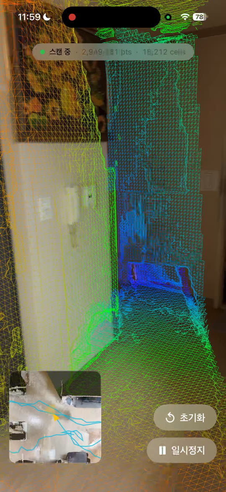
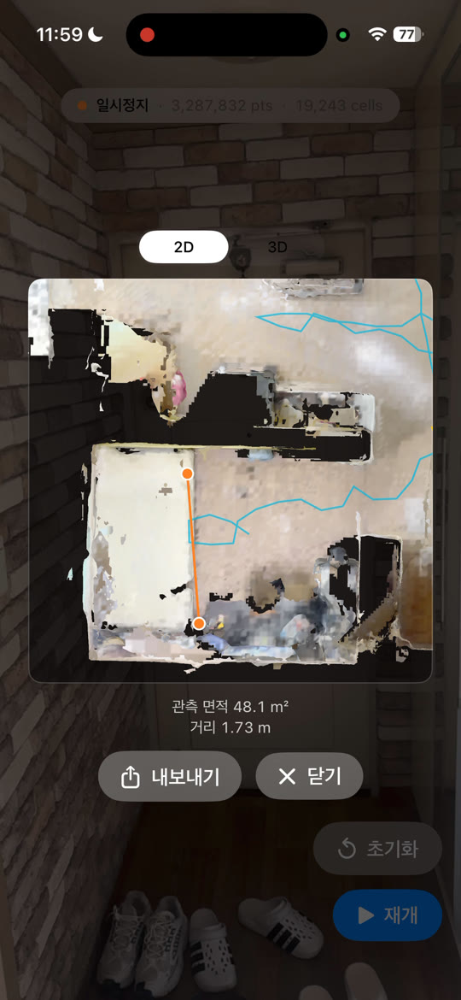
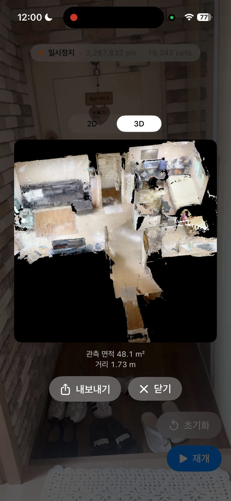

# BenchMarkVideo

> 걸으며 비추기만 하면, 방의 지도가 위에서 본 모습으로 그려지는 LiDAR 공간 스캔 앱

iPhone의 LiDAR로 방을 걸으며 비추면 카메라 화면 위에 스캔한 영역이 겹쳐 보이고, 화면 구석의 미니맵에는 위에서 내려다본 방의 지도가 실시간으로 채워집니다. 지도 위에는 지금 내 위치와 바라보는 방향, 지나온 길이 함께 표시됩니다.

스캔을 마치면 지도를 전체화면으로 펼쳐 2D 평면도와 3D 모형으로 살펴보고, 두 점을 찍어 거리와 면적을 재고, 결과를 `.ply` 파일로 내보낼 수 있습니다. 줄자나 별도 장비 없이 방 구조를 빠르게 파악하고 공유하는 것이 목표입니다.

## :fireworks: Screenshots

  
  
  

왼쪽부터 스캔 중 화면 · 전체화면 2D 거리 측정 · 3D 모형 (같은 집 48.1㎡)

## :pushpin: 주요 기능

- **스캔 시작·일시정지·재개·초기화**: 버튼 하나로 스캔을 시작하고, 상황에 맞게 버튼이 일시정지·재개·초기화로 바뀝니다. 일시정지해도 위치와 지나온 길은 계속 기록되어, 재개하면 떨어진 두 공간이 실제 거리만큼 이어져 그려집니다.
- **실시간 스캔 표시**: 스캔 중에는 카메라 화면 위에 이미 훑은 곳이 와이어프레임으로 겹쳐 보여, 어디를 더 비춰야 하는지 바로 알 수 있습니다.
- **실시간 미니맵**: 좌하단 미니맵에 위에서 본 방의 지도가 걸음에 맞춰 채워집니다. 벽은 카메라에 비친 색 그대로, 바닥은 조금 어둡게 칠해지고 지도는 항상 같은 방향(north-up)을 유지합니다.
- **현재 위치·방향과 이동 궤적**: 삼각형 마커와 시야 부채꼴로 내 위치와 바라보는 방향을, 선으로 지나온 길을 보여 줍니다.
- **전체화면 2D/3D 뷰어**: 미니맵을 탭하면 스캔이 잠시 멈추고 전체화면 지도가 열립니다. 2D 평면도는 핀치로 확대하고 드래그로 옮길 수 있고, 3D 모형은 돌려 보며 방 안을 들여다볼 수 있습니다.
- **거리·면적 측정**: 지도에서 두 점을 탭하면 거리를 미터로 알려 주고, 지금까지 스캔한 면적(㎡)도 함께 표시합니다. 1.4m 책상을 1.38~1.40m로 측정했습니다.
- **스캔 결과 내보내기**: 스캔한 공간을 `.ply` 점군 파일로 만들어 공유 시트나 AirDrop으로 보낼 수 있습니다.
- **상태·트래킹 안내**: 대기·스캔 중·일시정지 상태와 누적 포인트 수를 보여 주고, 특징점이 부족하거나 위치를 다시 찾는 중이면 안내 배지를 띄웁니다. 카메라 권한이 없거나 LiDAR가 없는 기기에서는 이유와 해결 방법을 안내합니다.

## :walking: 사용 흐름

1. 앱을 열고 카메라 권한을 허용한 뒤 "스캔 시작"을 누릅니다.
2. 방을 천천히 걸으며 벽과 바닥을 비춥니다. 미니맵이 걸음에 맞춰 채워집니다.
3. 미니맵을 탭해 전체화면으로 펼치고, 2D 평면도와 3D 모형을 오가며 결과를 확인합니다.
4. 두 점을 찍어 거리를 재거나 `.ply`로 내보냅니다. 닫으면 스캔이 이어집니다.

## :sparkles: 기술 스택

  
  
  
  
  
  
  

- 서드파티 라이브러리 없이 Apple 시스템 프레임워크(ARKit, RealityKit, SceneKit, SwiftUI, Observation, CoreGraphics, simd, XCTest)만 사용합니다. 깊이 역투영은 Apple 샘플 [Visualizing a Point Cloud Using Scene Depth](https://developer.apple.com/documentation/arkit/displaying-a-point-cloud-using-scene-depth)의 방식을 참고해 직접 다시 작성했습니다(Apple Sample Code License, 개념 참고 범위).
- 구조는 MVVM이며, 깊이 처리는 전용 직렬 큐에서 돌고 화면은 `AsyncStream` 하나로 결과를 받습니다.

## :bar_chart: 성능

- iPhone 15 Pro 실기기에서 스캔 중에도 화면이 **60fps**를 유지합니다.
- **3분 이상 연속 스캔**(최장 4.5분)에서 강제 종료나 메모리 경고가 없었습니다.

## :gear: 개발 정보

| 항목 | 내용 |
| --- | --- |
| 개발 기간 | 2026.09.04 ~ 2026.09.12 |
| 개발 환경 | Xcode 26.1, Swift 5 + Approachable Concurrency, iOS 17.0 이상 |
| 테스트 기기 | iPhone 15 Pro (iOS 26.6) — LiDAR가 있는 기기에서만 동작 |

### 실행 방법

1. 저장소를 클론하고 `BenchMarkVideo.xcodeproj`를 엽니다.
2. scheme `BenchMarkVideo-Production`(실사용·성능 확인용 Release)을 고릅니다. 진단 패널이 있는 `BenchMarkVideo-Development`의 차이는 개발 문서에 있습니다.
3. Signing & Capabilities에서 본인 팀을 지정합니다(bundle ID `com.doran.benchmarkvideo`, 필요하면 변경).
4. LiDAR 기기(iPhone 12 Pro 이상 Pro 계열, iPad Pro 2020 이상)를 연결하고 Run합니다. 시뮬레이터는 깊이 정보가 없어 "지원되지 않는 기기" 화면이 뜹니다.

## :technologist: 개발자

<table>
  <tr>
    <td align="center">
      <a href="https://github.com/HappyDoran">
         
        <b>HappyDoran</b>
      </a> 
      iOS 개발 (1인)
    </td>
  </tr>
</table>

## :books: 더 읽을거리

- [개발·검증 가이드](docs/DEVELOPMENT.md) — 요구사항 구현 체크리스트(R1~R4), 아키텍처, 성능 측정 결과(R3) 상세, 알려진 버그·제약, 빌드·테스트 명령, 진단 패널, 실기기 수동 검증 매트릭스
- [설계 문서](DESIGN.md) — 파이프라인과 설계 판단 근거
- [LLM 활용 리포트](LLM_REPORT.md) — LLM과 사람의 역할 구분, 기각·수정 사례
